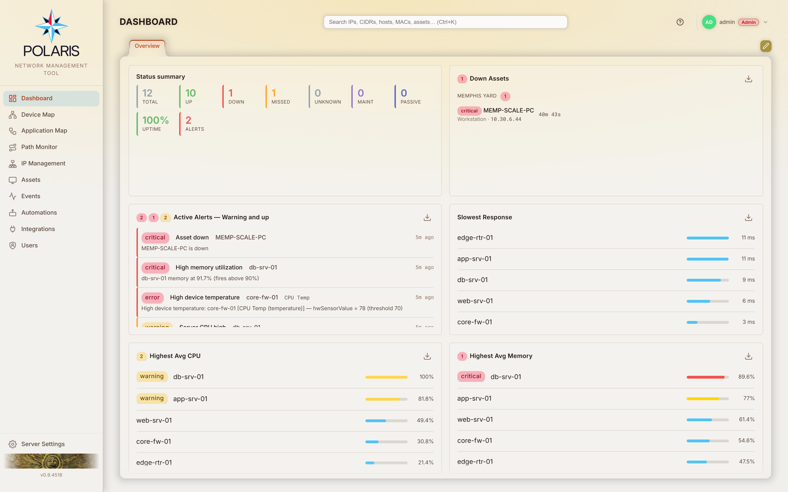
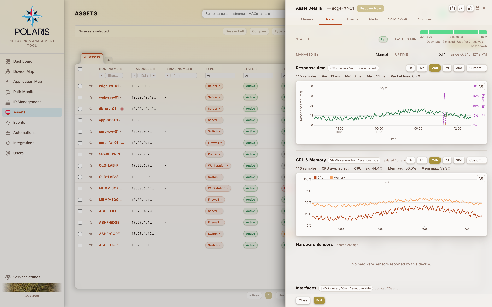
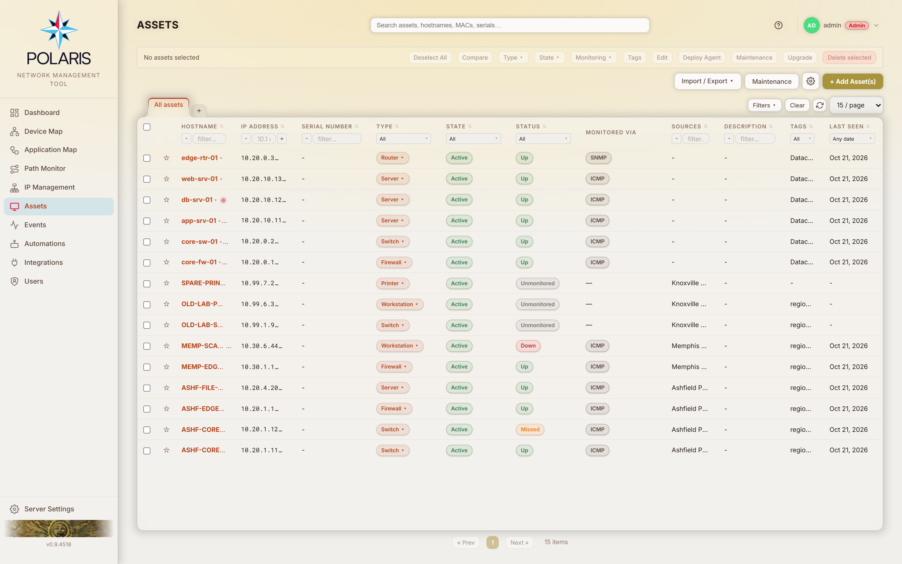

# Polaris

**Polaris monitors your network and the devices on it, and keeps one inventory of what those devices are, built from the systems you already run.**

Point it at your FortiManager, vCenter, Entra ID, Active Directory, Proxmox or any of its other integrations. Each device they know about becomes one asset record. Polaris polls those assets over SNMP, FortiOS REST, SSH, WinRM, ICMP or its own agent, charts what comes back, and alerts the right people when something breaks. It also works out which alerts are just symptoms of a single outage. Self-hosted and open source, it runs on fleets from one device to more than 2,000.

<picture>
  <source media="(prefers-color-scheme: dark)" srcset="docs/img/screenshots/desktop-nightfall-dashboard.png">
  
</picture>

<sub>Every screenshot on this page comes from a development instance seeded with **invented** devices, addresses and alerts. See [DEVELOPMENT.md](DEVELOPMENT.md#demo-data-and-documentation-screenshots).</sub>

## Monitoring

What Polaris is for. Full detail: [How monitoring works](https://github.com/rogers-group-inc/polaris/wiki/Monitoring).

- **Eight telemetry streams, each on its own cadence**: response time, CPU/memory, hardware sensors, interfaces, LLDP neighbours, storage, processes and event logs. A slow stream never starves a fast one, and the transport resolves per stream, per asset. Transports are FortiOS REST, SNMP, SSH, WinRM, ICMP (batched through `fping`), the vCenter / Unraid / TrueNAS / Proxmox APIs, and an optional **Polaris Agent** for Linux, macOS and Windows.
- **Down detection that doesn't flap.** Misses accumulate in a leaky bucket, so a device that drops every other packet still reaches a verdict. Recovery takes exactly as many good polls as you asked for. How many misses count as "down" belongs to the alert you wrote, not to a global setting: core switches can go down after 2, workstations after 10. → [Monitor states](https://github.com/rogers-group-inc/polaris/wiki/Monitor-States)
- **One alert, not fifty.** A dependency graph built from FortiLink, CAPWAP, LLDP and hypervisor placement suppresses everything behind a device that is down. When a core switch dies you get paged once, and its dependants come back in the same moment it does. → [Dependency suppression](https://github.com/rogers-group-inc/polaris/wiki/Dependency-Suppression)
- **Quiet when it's supposed to be.** Maintenance windows, ad-hoc holds, and the holds Polaris takes on itself while it reboots or upgrades a device. Polaris never pages anyone about downtime it caused. → [Maintenance windows](https://github.com/rogers-group-inc/polaris/wiki/Maintenance-Windows)
- **Automations** watch a metric, a state, an event or a change, then raise an alert at a severity. They notify by email, push or webhook, escalate when nobody acknowledges, respect quiet time, and can call an API, run a script or book a reboot. A baseline set ships enabled. → [Automations](https://github.com/rogers-group-inc/polaris/wiki/Automations)
- **Charts for everything collected**: response time and packet loss, CPU and memory, temperature per sensor, throughput and errors per interface, storage, IPsec tunnels, SD-WAN members. Pin an interface, a mountpoint or a tunnel to give it sub-minute history and make it alertable.
- **Application Map**: a graph of the traffic the agent observes between processes and services on your hosts. It shows what actually talks to what, port by port. → [Application Map](https://github.com/rogers-group-inc/polaris/wiki/Application-Map)
- **Dashboards, wallboards and your phone.** A per-user widget dashboard you can publish to the team. A no-login `/dash` view for NOC screens. An installable mobile app for acknowledging alerts on the move. → [Dashboard](https://github.com/rogers-group-inc/polaris/wiki/Dashboard) · [Mobile and Dash](https://github.com/rogers-group-inc/polaris/wiki/Mobile-and-Dash)

<picture>
  <source media="(prefers-color-scheme: dark)" srcset="docs/img/screenshots/desktop-nightfall-asset-monitoring.png">
  
</picture>

## Asset management

How Polaris knows what to monitor. Full detail: [Assets](https://github.com/rogers-group-inc/polaris/wiki/Assets) · [Discovery](https://github.com/rogers-group-inc/polaris/wiki/Discovery).

- **Eleven integrations fill the inventory**: FortiManager, standalone FortiGate, Entra ID / Intune, Active Directory, Windows DHCP, VMware vCenter, Azure Arc, Unraid, TrueNAS SCALE, Proxmox VE, and a build-your-own **Generic API** for any REST feed that lists devices. Every integration is optional and read-only by default.
- **One record per device, from every source that knows it.** A laptop that AD, Intune, Azure Arc and a FortiGate all report is one row with four sources. Each field takes its value from the source most trustworthy *for that field*, not from whichever system wrote last. A **Sources** tab shows what each one said.
- **Disagreements become conflicts, not silent overwrites.** Two records with one serial, one address claimed by two devices, a replaced FortiGate chassis: each lands in a review queue. → [Conflict resolution](https://github.com/rogers-group-inc/polaris/wiki/Conflict-Resolution)
- **What's discovered gets monitored.** For each class of device it finds (FortiSwitches, servers, VMs, containers and so on), an integration can add it as monitored, with the polling method and credentials per stream. It can also deploy the agent automatically. Workloads are parented by the host they run on, so a host outage suppresses everything on it. A device that leaves its source can be decommissioned automatically, behind guards that refuse to act on a truncated or empty read.
- **No integrations at all also works.** Enter assets by hand and monitor them over SNMP, SSH, WinRM, ICMP or the agent.
- MAC history, serials, warranty, OS, location and installed software, plus saved filters and per-user view tabs on the Assets table.

<picture>
  <source media="(prefers-color-scheme: dark)" srcset="docs/img/screenshots/desktop-nightfall-assets.png">
  
</picture>

## Also in the box

- **Path Monitor**: HTTP, HTTPS, TCP or ping checks run from the hosts your users sit on, with NetPath-style traceroutes. → [Path Monitor](https://github.com/rogers-group-inc/polaris/wiki/Path-Monitor)
- **Device Map**: every FortiGate on a map, coloured by health. Each opens a topology graph of its FortiSwitches, FortiAPs, subnets and LLDP neighbours. → [Device Map](https://github.com/rogers-group-inc/polaris/wiki/Device-Map)
- **Fortinet depth**: FortiLink and CAPWAP controller-link state (a switch the gate has stopped managing still answers ping), SD-WAN members, and IPsec phase-1/phase-2 tunnels. → [Fortinet integration](https://github.com/rogers-group-inc/polaris/wiki/Integration-Fortinet)
- **IP address management**: blocks, networks, reservations, conflict detection, utilization and templated site allocation. → [IPAM](https://github.com/rogers-group-inc/polaris/wiki/IPAM)
- **DHCP reservation push and lease release** to FortiGates, verified by read-back and queued through outages.
- **MAC quarantine** pushed to every FortiGate that has seen the device, from the UI or a SIEM.
- **Firmware upgrades and reboots** for FortiGates, FortiSwitches and FortiAPs (reboots for agent hosts too), immediate or booked. Each takes a maintenance hold and only reports success on proof the device restarted.
- **AI assistant**: connect a model server you run, or an Azure AI Foundry deployment, and ask about devices, alerts and events with your own permissions. → [AI assistant](https://github.com/rogers-group-inc/polaris/wiki/AI-Assistant)
- **MIB database**: upload a vendor's MIB and its telemetry resolves by symbol name. No vendor OIDs are baked into the code.
- **REST API** with role-bound tokens, plus a Prometheus `/metrics` endpoint and a Grafana dashboard. Polaris also reports capacity and platform end-of-life for its own host. → [REST API](https://github.com/rogers-group-inc/polaris/wiki/API)
- **Audit trail**: every create, update, delete and discovery event, with syslog (CEF) forwarding and SFTP archival. → [Events](https://github.com/rogers-group-inc/polaris/wiki/Events)

## Built for any install

Polaris is FOSS and makes no assumptions about how you run it.

- **Fleet size**: 1 to 2,000+ monitored assets. Split the process into `web`, `monitor`, `discovery` and `dash` roles when you grow.
- **Sign-in**: local accounts (with TOTP or passkeys), LDAP/AD, Azure SAML, OIDC, or Entra Application Proxy header SSO. Custom roles come from a per-function permission matrix.
- **Platforms**: RHEL / Rocky / Alma 9, Ubuntu / Debian, Docker / podman, Unraid. TLS terminates wherever you like: direct, nginx, a load balancer, or not at all on a lab VM.
- **Optional high availability**: an active/standby pair on Patroni and etcd. → [docs/HA.md](docs/HA.md)
- **Updates** from inside the app, with automatic rollback. Backups are encrypted.

## Documentation

| | |
|---|---|
| **[Wiki](https://github.com/rogers-group-inc/polaris/wiki)** | **Operator documentation**: a page per screen, how to configure each integration, how monitoring and automations actually decide things, and every numbered business rule behind that behaviour. In the app it is the **Help** entry in the account menu (click your username, top right). Source lives in [`docs/wiki/`](docs/wiki/) and is published from there |
| [docs/INSTALL.md](docs/INSTALL.md) | **Fresh installs**: supported platform versions, disk sizing, split-role deployment, nginx, and the environment problems that bite |
| [docs/UPGRADING.md](docs/UPGRADING.md) | **Existing installs**: moving to PostgreSQL 17, upgrading Node or the signing JDK, migrating to the nginx front end, and recovering an update that failed on TLS interception |
| [docs/HA.md](docs/HA.md) | The optional active/standby pair, phase by phase |
| [DEVELOPMENT.md](DEVELOPMENT.md) | The local dev stack |
| `<polaris-url>/api` | Developer docs for the REST API, served by the install itself (no login; private networks only). Also packaged as the [`polaris-api-conventions`](https://github.com/rogers-group-inc/polaris-api-conventions) Claude Code plugin |

## System requirements

| Resource | Minimum (<50 devices) | Recommended (200+ devices, 200K+ reservations) |
|----------|----------------------|-----------------------------------------------|
| CPU | 2 vCPU | 4 vCPU |
| RAM | 4 GB | 8 GB |
| DB data volume | 50 GB SSD | 100 GB+ SSD |
| App / state volume | 5 GB | 20 GB |
| OS | RHEL 9, Ubuntu 22.04+ | RHEL 9, Ubuntu 24.04 LTS |
| PostgreSQL | 17+ (with TimescaleDB) | 17 (with TimescaleDB) |
| Node.js | 22.12 (hard floor) | 24 LTS |

> **The minimum column is a floor, not a recommendation, and one of these is close to end of
> life**: Node 22 ends 2027-04-30, so a host on the floor has under a year of runway.
> [docs/INSTALL.md](docs/INSTALL.md) → "Supported platform versions" is the canonical table:
> minimum, what Polaris targets, and every upstream EOL date. A running install grades itself
> against it under Server Settings → Maintenance → Platform Lifecycle.

Monitoring sample tables grow with monitored assets × cadence × retention, and the **DB data volume** is the number that matters most. See [docs/INSTALL.md](docs/INSTALL.md) → "Disk sizing — read this first". Once a host has been monitoring for about 15 minutes, Server Settings → Maintenance → **Capacity Advisor** recommends PostgreSQL settings for the workload it has observed.

## Installing

**RHEL / Rocky / Alma 9** or **Ubuntu / Debian**: the setup script installs Node.js 24, PostgreSQL 17 with TimescaleDB, nginx, the `polaris` system user and the split-role services, and generates the session and credential-encryption secrets.

```bash
git clone https://github.com/rogers-group-inc/polaris.git && cd polaris
bash deploy/setup-rhel.sh        # or: bash deploy/setup-ubuntu.sh
```

When the script finishes, log in with `admin` / `admin` and change the password. Update from **Server Settings → Maintenance → Update** afterwards.

**Docker / Unraid:**

```bash
docker pull ghcr.io/rogers-group-inc/polaris:latest
```

PostgreSQL is not included. Run `timescale/timescaledb:latest-pg17`, not plain `postgres:17`, and start it with `-c shared_preload_libraries=timescaledb`. Bind-mount `/app/state` and keep that mount across upgrades. Container port `3000` is HTTP only, so put TLS in a reverse proxy. On first launch a setup wizard asks for the one-time setup token printed in the container log. Update by pulling a new tag. For the bind-mount layout and first-launch details, see [docs/INSTALL.md → Single container (Unraid)](docs/INSTALL.md#single-container-unraid). For the multi-container compose stack, see [→ Docker](docs/INSTALL.md#docker).

**Development:**

```bash
npm install
cp .env.example .env          # point DATABASE_URL at a PostgreSQL 17 + TimescaleDB instance
npx prisma migrate dev --name init
npm run db:seed               # optional sample data
npm run dev                   # http://localhost:3000
```

See [DEVELOPMENT.md](DEVELOPMENT.md) for the podman dev stack and demo data.

## Security

- TLS 1.2+ with AEAD-only cipher suites and configurable certificates
- Helmet Content Security Policy, HSTS, X-Frame-Options
- Synchronizer-token CSRF protection on every state-changing call (`polaris_csrf` cookie + `X-CSRF-Token` header)
- 10 login attempts / 15-minute window per IP; per-account temporary lockout after repeated failures
- HttpOnly + SameSite=Lax session cookies, session ID regenerated on login, configurable inactivity timeout
- Argon2id password hashing; argon2id-hashed API tokens with timing-safe lookup
- Device and integration credentials encrypted at rest with `POLARIS_SECRET_KEY`
- Setup wizard self-locks after first run via a `.setup-complete` marker, and needs a one-time setup token before then

## Running tests

```bash
npm test                  # all tests once
npm run test:watch        # watch mode
npm run test:coverage     # with coverage report
```

## Tech stack

| Layer | Technology |
|-------|-----------|
| Runtime | Node.js 24 LTS / TypeScript (ESM) — floor is 22.12 |
| Framework | Express 5 |
| ORM | Prisma 7 (driver-adapter via `@prisma/adapter-pg`) |
| Database | PostgreSQL 17 + TimescaleDB |
| Sessions | express-session + connect-pg-simple |
| Validation | Zod |
| Logging | Pino |
| Auth | argon2id, `@node-saml/node-saml`, `otpauth` + `qrcode`, `@simplewebauthn/server` |
| IP math | `netmask` |
| LDAP | `ldapts` |
| Monitoring transports | `net-snmp`, `ssh2`, built-in `node:https` (FortiOS REST + WinRM SOAP), system `ping` / `fping` |
| Agent | Go (Linux / macOS / Windows, amd64 + arm64) |
| Mapping | Leaflet + leaflet.markercluster + leaflet-draw + OpenStreetMap |
| Graph layout | Cytoscape.js + dagre + cytoscape-dagre |
| PDF | jspdf + jspdf-autotable |
| Security | Helmet, express-rate-limit |
| Testing | Vitest + Supertest |
| Frontend | Vanilla JavaScript + HTML, served from `/public` (no build step) |
